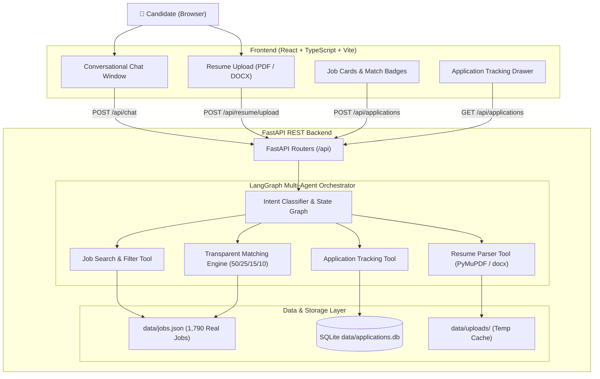

<<<<<<< HEAD
=======

# AI_Job_Assistant
AI-powered job assistant that helps users find relevant job opportunities, analyze resumes, and improve their job search using intelligent recommendations.

>>>>>>> ab86ad7 (Frontend data changes)
# AI Job Chat Assistant

[](https://www.python.org/)
[](https://fastapi.tiangolo.com)
[](https://github.com/langchain-ai/langgraph)
[](https://react.dev)
[](https://www.typescriptlang.org/)
[](https://www.sqlite.org/)
[](LICENSE)

An enterprise-grade, conversational AI Job Assistant built for the **Hidani Tech – SDE Intern (AI Agents & Automation)** assessment. It features resume parsing (PDF/DOCX), an indexed dataset of **1,790 verified real job listings**, transparent 4-factor match scoring, a **LangGraph multi-agent orchestrator**, and SQLite job application tracking with duplicate prevention.

---

## 🚀 Key Features

- 📄 **High-Accuracy Resume Parsing**: Extracts structured profile data (name, email, phone, designation, skills, experience, education, projects) from PDF (via **PyMuPDF**) and Word documents (via **python-docx**).
- 🌐 **1,790 Real Job Listings**: Harvested from permitted public job feeds (Arbeitnow, Jobicy, Remotive) using an ethical, rate-limited scraping pipeline (`scraper/`) with a built-in dataset validator.
- 🎯 **Transparent 4-Factor Matching**: Calculates auditable match scores:
  - **Skills Overlap (50%)**
  - **Designation Relevance (25%)**
  - **Experience Compatibility (15%)**
  - **Location / Remote Fit (10%)**
  *(No LLM hallucinations or false hiring probability claims)*.
- 🤖 **LangGraph Multi-Agent Orchestrator**: Uses a stateful `StateGraph` with intent classification and conditional routing to invoke only relevant agent tools.
- 💬 **Conversational Context & Filters**: Understands conversational follow-ups like *"Show only remote jobs"*, *"Find Spring Boot roles"*, and *"Apply to job 2"*.
- 📋 **Application Tracking & Deduplication**: Persists applications in SQLite (`data/applications.db`) with a strict `UNIQUE(session_id, job_id)` constraint to prevent duplicate submissions.
- 🛡️ **Offline Deterministic Fallback**: Works 100% out of the box when `OPENAI_API_KEY=mock`, passing all test suites without paid API credits.
- 💻 **Polished React UI**: Built with React 18, TypeScript, and Vite featuring chat bubbles, match badges, 1-click sample profile loading, and an application tracker drawer.

---

## 🏗️ System Architecture



---

## 📊 Dataset Validation Summary

Run the automated validator to inspect dataset integrity:
```powershell
.\.venv\Scripts\python.exe -m scraper.validator data/jobs.json
```

**Validated Metrics**:
- **Total Records Collected**: 1,790
- **Usable, Valid Records**: 1,790 (100% Schema Valid)
- **Duplicate IDs Detected**: 0
- **Duplicate URLs Detected**: 0
- **Missing Mandatory Fields**: 0
- **Invalid URLs**: 0
- **Source Breakdown**:
  - Arbeitnow: 1,632 jobs (91.2%)
  - Jobicy: 146 jobs (8.2%)
  - Remotive: 12 jobs (0.7%)
- **Work Mode Distribution**:
  - Onsite: 1,363 jobs (76.1%)
  - Remote: 391 jobs (21.8%)
  - Hybrid: 36 jobs (2.0%)

---

## 🛠️ Project Structure

```
assesment project/
├── backend/
│   ├── app/
│   │   ├── agents/          # LangGraph state machine & multi-agent nodes
│   │   │   ├── orchestrator.py
│   │   ├── api/             # FastAPI REST endpoints
│   │   │   ├── applications.py
│   │   │   ├── chat.py
│   │   │   ├── health.py
│   │   │   ├── jobs.py
│   │   │   └── resume.py
│   │   ├── core/            # Configuration & Settings
│   │   │   └── config.py
│   │   ├── database/        # SQLite connection & schema initialization
│   │   │   └── connection.py
│   │   ├── schemas/         # Pydantic schemas (Job, Resume, Application, Chat)
│   │   ├── services/        # Business logic (ResumeParser, JobService, ApplicationService)
│   │   └── main.py          # FastAPI application entry point
│   └── requirements.txt
├── frontend/
│   ├── src/
│   │   ├── components/      # Header, Sidebar, JobCard, ChatInput, ApplicationsDrawer
│   │   ├── services/        # API client
│   │   ├── types/           # TypeScript interfaces
│   │   ├── App.tsx          # Main layout & state coordinator
│   │   └── App.css          # Modern SaaS styling
│   ├── package.json
│   └── vite.config.ts
├── scraper/
│   ├── main.py              # CLI collection pipeline
│   ├── sources.py           # Permitted API sources (Arbeitnow, Jobicy, Remotive)
│   ├── normalizer.py        # HTML stripping, skill extraction & deduplication
│   ├── validator.py         # Schema & URL validation report
│   └── README.md
├── data/
│   ├── jobs.json            # 1,790 real job listings
│   ├── applications.db      # SQLite application tracker
│   └── uploads/             # Temporary resume storage
├── docs/
│   ├── architecture.md      # Detailed system architecture
│   ├── dataflow.md          # Sequence diagrams of data lifecycle
│   ├── api.md               # Complete REST API reference
│   └── interview_guide.md   # Developer interview Q&A guide
├── tests/
│   ├── agents/              # LangGraph multi-agent & workflow tests
│   ├── backend/             # Health, Database, Job, Resume tests
│   └── scraper/             # Normalizer & validator tests
├── .env.example
├── .gitignore
├── pytest.ini
└── README.md
```

---

## 💻 Local Setup & Startup Guide (Windows PowerShell)

### Prerequisites
- Python 3.11+ (Python 3.13 recommended)
- Node.js 18+ and npm

### 1. Setup Python Virtual Environment
```powershell
# In project root directory
py -3.13 -m venv .venv
.\.venv\Scripts\pip.exe install -r backend/requirements.txt
```

### 2. Configure Environment Variables
Copy `.env.example` to `.env`:
```powershell
Copy-Item .env.example .env
```
*(By default, `OPENAI_API_KEY=mock` enables offline deterministic mode with full functionality. To use live OpenAI generation, set `OPENAI_API_KEY=sk-...`)*.

### 3. Setup Frontend Dependencies
```powershell
cd frontend
npm.cmd install
cd ..
```

---

## 🚀 Running the Application

### Terminal 1: Start FastAPI Backend
```powershell
.\.venv\Scripts\uvicorn.exe backend.app.main:app --host 127.0.0.1 --port 8000 --reload
```
API Documentation will be available at: **http://127.0.0.1:8000/docs**

### Terminal 2: Start React Frontend
```powershell
cd frontend
npm.cmd run dev
```
Open your browser at: **http://localhost:5173**

---

## 🧪 Running Automated Tests

Run the complete test suite (26 passing tests):
```powershell
.\.venv\Scripts\pytest.exe -v
```

Tests include:
- `tests/agents/test_orchestrator.py`: Multi-turn conversational workflows & LangGraph routing.
- `tests/backend/test_database.py`: SQLite application persistence & duplicate prevention.
- `tests/backend/test_resume_parser.py`: PyMuPDF PDF & python-docx extraction.
- `tests/backend/test_jobs.py`: 1,790 real jobs dataset search & transparent scoring.
- `tests/scraper/test_scraper.py`: Normalizer, skill ontology & dataset validator.

---

