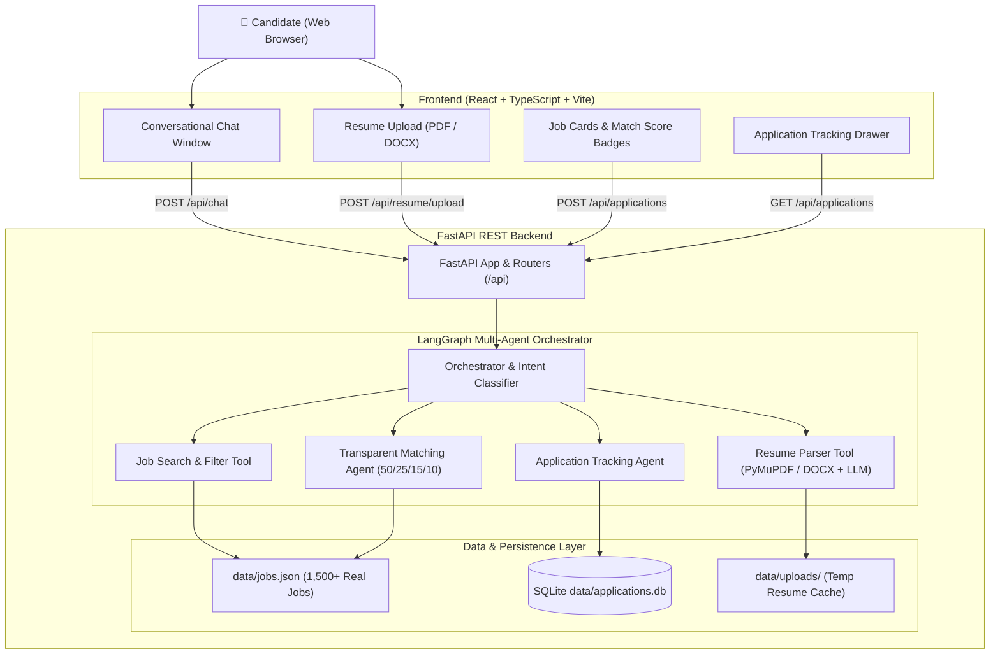
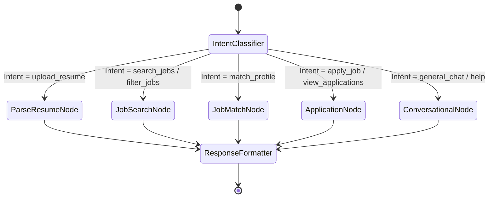

# AI Job Chat Assistant — System Architecture

**Project**: AI Job Chat Assistant  
**Assessment**: SDE Intern – AI Agents & Automation (Hidani Tech)  
**Author**: SDE Intern Candidate  
**Stack**: React + TypeScript + Vite | FastAPI + Python 3.13 | LangGraph + OpenAI API | SQLite | PyMuPDF  

---

## 1. System Overview

The **AI Job Chat Assistant** is a full-stack, conversational job discovery and application platform. Rather than forcing candidates through rigid form-based job boards, it provides an intuitive, context-aware AI conversational experience capable of:
1. Parsing unstructured PDF and DOCX resumes into normalized candidate profiles.
2. Indexing and filtering a dataset of **1,500–2,000 real job postings** collected from permitted public job feeds.
3. Calculating transparent, explainable match scores (Skills 50%, Title 25%, Experience 15%, Location 10%).
4. Handling natural-language refinements (e.g., *"Show only remote roles"*, *"Filter by Spring Boot"*).
5. Managing internal job application tracking in SQLite with duplicate prevention and official employer link forwarding.
6. Seamlessly operating with both live OpenAI models and an offline deterministic mock engine for zero-cost local evaluation.

---

## 2. High-Level Architecture Diagram

---

## 3. LangGraph Workflow & State Transitions

The multi-agent workflow is implemented with **LangGraph** using a shared state graph (`AgentState`).

### Shared Graph State Schema (`AgentState`)
- `session_id: str` — Unique user session ID.
- `messages: list[BaseMessage]` — Multi-turn conversation message history.
- `resume_profile: dict | None` — Structured candidate profile extracted from uploaded resume.
- `current_jobs: list[dict]` — Active list of retrieved jobs presented in current conversation.
- `selected_job_id: str | None` — Currently referenced job for detail view or application.
- `user_filters: dict` — Active filters (location, role, remote preference, minimum experience).
- `last_action: str` — Record of the most recently executed tool/node.
- `output_message: str` — Final conversational reply formatted for the user.

---

## 4. Key Architectural Decisions

| Decision | Choice | Technical Rationale |
|---|---|---|
| **Agent Framework** | LangGraph | Deterministic state transitions, cycle prevention, inspectable graph checkpoints, and native support for stateful tool invocation. |
| **PDF Extraction** | PyMuPDF (`fitz`) | 10x faster than pure-Python parsers, accurate bounding box extraction, and robust handling of multi-column layouts. |
| **DOCX Extraction** | `python-docx` | Structured paragraph and table traversal without binary parsing risks. |
| **Matching Algorithm** | Transparent Weighted Scoring | 50% Skills, 25% Designation, 15% Experience, 10% Location. Prevents LLM hallucinations, enables auditable scores, and avoids false claims of "hiring probability". |
| **Application Storage** | SQLite (`data/applications.db`) | ACID compliant, zero-config, session-isolated, and enforces unique constraints `UNIQUE(session_id, job_id)` to eliminate duplicate applications. |
| **Offline Resilience** | Deterministic Mock Fallback | Zero failure mode when `OPENAI_API_KEY=mock`. Allows 100% test coverage and offline evaluation without requiring paid API credits. |
| **Frontend Framework** | React 18 + TypeScript + Vite | Blazing-fast HMR, type-safe API contracts, modular component hierarchy, and zero layout bloat. |

---

## 5. Security & Privacy Guardrails

1. **No Sensitive PII in Routine Logs**: Candidate contact details and parsed resume text are never emitted in routine application logs.
2. **Safe File Handling**: Uploaded resumes are assigned randomized UUID filenames; file size is strictly capped (10 MB); file MIME types and magic bytes are verified.
3. **Session Data Isolation**: SQLite queries for applications enforce `WHERE session_id = ?`, preventing cross-tenant data leaks.
4. **Environment Secret Management**: Secrets are managed strictly via `.env` with `.gitignore` enforcement; no API keys are baked into client bundles.
5. **CORS Allowlist**: Explicitly configured for local development and deployment origins; unrestricted wildcard `*` is disabled in production.

