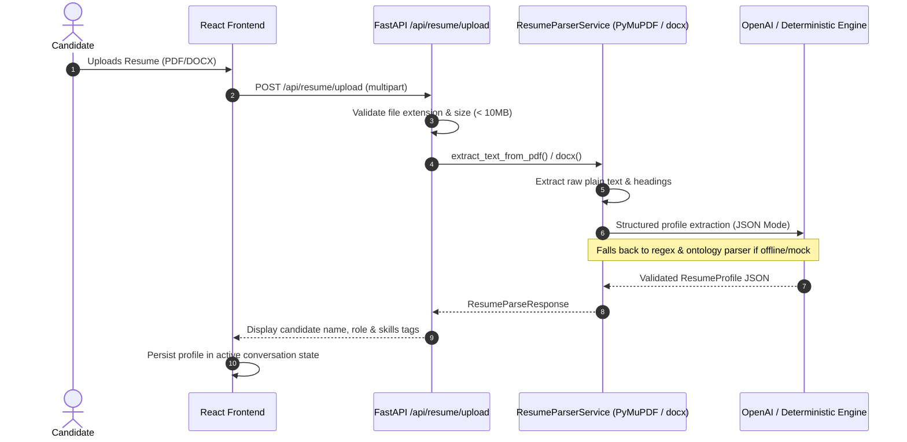
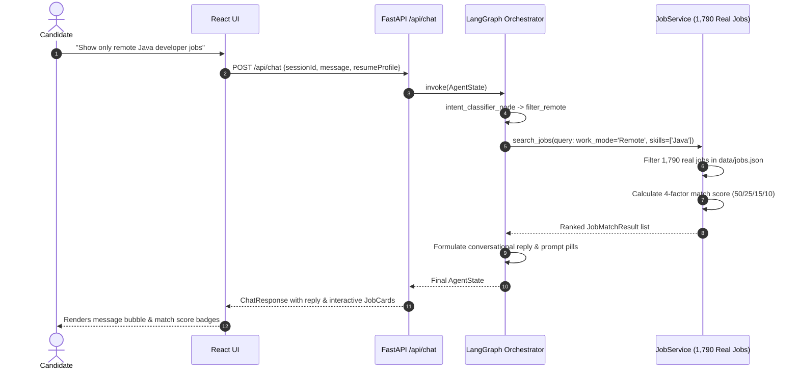
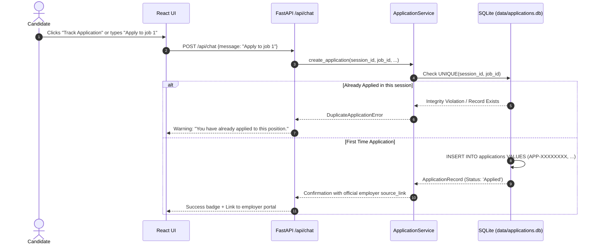

# AI Job Chat Assistant — End-to-End Dataflow

This document traces the complete lifecycle of data across candidate interactions, multi-agent graph nodes, dataset indexing, and database persistence.

---

## 1. Resume Upload & Profile Extraction Flow

---

## 2. Conversational Job Matching & Filtering Flow

---

## 3. Application Tracking Flow with Duplicate Prevention

